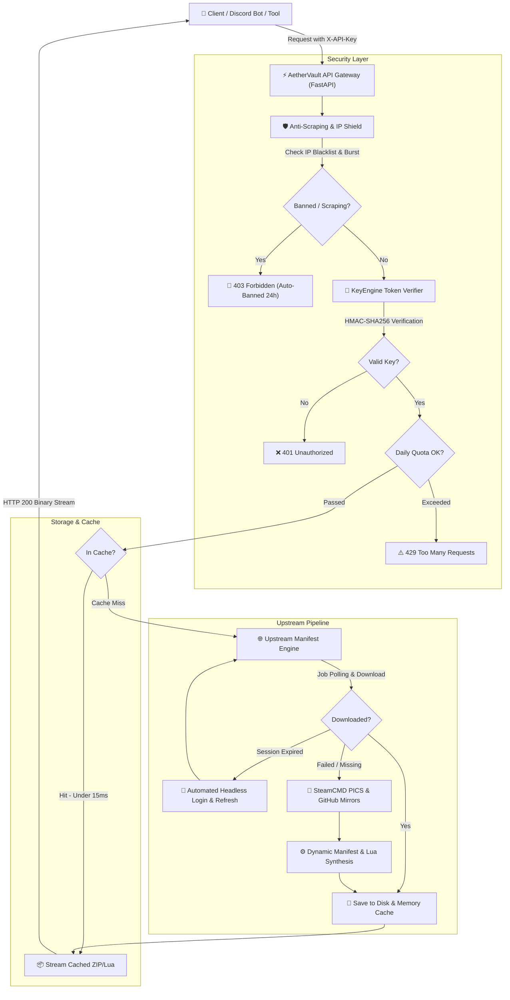

<div align="center">

```
     ___   ______ _____ _   _ _____ ______ _   _ ___   _   _ _ _____ 
    / _ \ |  ____|_   _| | | |  ___|  __  | | | / _ \ | | | | |_   _|
   / /_\ \| |__    | | | |_| | |__ | |__) | | |/ /_\ \| | | | | | |  
   |  _  ||  __|   | | |  _  |  __||  _  /| | |  _  || | | | | | |  
   | | | || |____  | | | | | | |___| | \ \| |_| | | || |_| | | | |  
   \_| |_/|______| |_| \_| |_/_____|_|  \_\\___/\_| |_/\___/  |_|  
```

# ⚡ AETHERVAULT
### *The Next-Generation Steam Depot Manifest & Lua Distribution Gateway*

<p align="center">
  <b>High-speed, enterprise-grade REST API providing instant access to Steam game depot manifests and Lua scripts.</b><br>
  <i>Built for developers, bot creators, and game management toolsets with cryptographic key authentication, in-memory caching, anti-scraping IP defense, and automated session rejuvenation.</i>
</p>

<p align="center">
  <a href="https://github.com/KINGODIN1124/Manifest/actions/workflows/ci.yml"></a>
  <a href="https://fastapi.tiangolo.com"></a>
  <a href="https://www.python.org"></a>
  <a href="https://www.docker.com"></a>
  <a href="LICENSE"></a>
  <a href="https://swagger.io"></a>
</p>

[✨ Try the Public Key](#-public-community-api-key-7-day-trial) • [🎁 1-Month Discord Key](#-want-1-month-extended-access-join-our-discord) • [🏛️ Architecture](#-system-architecture) • [🛡️ Anti-Scraping](#-anti-scraping-shield--ip-defense) • [📡 API Reference](#-rest-api-documentation) • [🤖 Discord Bot](#-discord-bot-1-month-key-claim-system)

---

</div>

## 🎁 Public Community API Key (7-Day Trial)

To test AetherVault immediately in your own tool, Discord bot, or script, use our active **Public Community Trial Key**:

```http
API Key: av_public_eyJraWQiOiJiMTQ0OGM3OTBiZTkiLCJsYWJlbCI6IjctRGF5IFB1YmxpYyBDb21tdW5pdHkgVHJpYWwiLCJ0aWVyIjoicHVibGljX3RyaWFsIiwiaWF0IjoxNzkxOTc0NDkzLCJleHAiOjE3OTI1NzkyOTN9.33dbe57879d144d332a0e60abe94f89d
```

| Parameter | Policy |
| :--- | :--- |
| **Validity** | **7 Days** (Public Community Trial) |
| **Daily Quota** | **30 requests / 24 hours** per IP |
| **Burst Threshold** | Maximum 5 requests / second (Strict anti-scraping enforced) |
| **Payload Format** | Complete `.zip` (with `.manifest` binaries & compiled `{appid}.lua`) |

### Quick Test in cURL:
```bash
curl -H "X-API-Key: av_public_eyJraWQiOiJiMTQ0OGM3OTBiZTkiLCJsYWJlbCI6IjctRGF5IFB1YmxpYyBDb21tdW5pdHkgVHJpYWwiLCJ0aWVyIjoicHVibGljX3RyaWFsIiwiaWF0IjoxNzkxOTc0NDkzLCJleHAiOjE3OTI1NzkyOTN9.33dbe57879d144d332a0e60abe94f89d" \
     "http://localhost:8000/api/v1/manifest/730" \
     -o "730.zip"
```

---

## 🚀 Want 1-Month Extended Access? Join Our Discord!

Need more than 30 requests per day? You can claim a **1-Month Extended Access Key** for **FREE** by joining our Discord community:

[](https://discord.gg/crackworld)

### Perks of 1-Month Discord Member Key:
- ⚡ **150 Requests per day** (5x higher limit)
- 📅 **Valid for 30 Full Days**
- 🛡️ **Priority Queue & Instant Redundancy**
- 🤖 **How to claim:** Simply type `/claimkey` in the bot channel on our Discord server!

---

## 🌟 Core Features

<table>
  <tr>
    <td width="50%">
      <h3>🔒 Cryptographic Token Minting</h3>
      <p>API keys are mathematically signed using HMAC-SHA256, allowing stateless validation while recording usage in a tamper-resistant local registry.</p>
    </td>
    <td width="50%">
      <h3>🛡️ Anti-Scraping & Auto-IP Ban</h3>
      <p>Automated shield monitoring burst requests. Rapid sequential crawlers (> 5 req/s) or malicious scanners are instantly blacklisted and banned for 24 hours.</p>
    </td>
  </tr>
  <tr>
    <td width="50%">
      <h3>🔄 Automated Session Rejuvenation</h3>
      <p>Never worry about session expiration. Built-in headless Playwright engine automatically detects expired cookies, signs back in, and updates secrets without downtime.</p>
    </td>
    <td width="50%">
      <h3>⚡ In-Memory & Disk Cache</h3>
      <p>Lightning-fast delivery (&lt;15ms for cached packages). Preserves server bandwidth and keeps response latency near-instantaneous.</p>
    </td>
  </tr>
  <tr>
    <td width="50%">
      <h3>🌐 Multi-Source Redundancy</h3>
      <p>If the upstream engine is missing an AppID, AetherVault automatically queries SteamCMD PICS and public GitHub mirrors, compiling fresh packages dynamically.</p>
    </td>
    <td width="50%">
      <h3>🤖 Built-in Discord Bot Key System</h3>
      <p>Includes a ready-to-run Discord Bot with the <code>/claimkey</code> command so your community members can generate their own 1-month keys automatically.</p>
    </td>
  </tr>
</table>

---

## 🏛️ System Architecture



---

## 🛡️ Anti-Scraping Shield & IP Defense

To prevent aggressive scraping and protect server resources, AetherVault includes a strict real-time defense layer:

1. **Burst Scraping Detection:** Any client IP sending more than 5 requests per second is flagged as an automated scraper.
2. **24-Hour IP Blacklist:** The offending IP is immediately banned for 24 hours (`HTTP 403 Forbidden`).
3. **Malicious Tool Filtering:** Automatic blocking of automated scanner signatures (e.g. `sqlmap`, `scrapy`, `nikto`).
4. **Administrative Controls:** Manage blacklist via CLI:
   ```bash
   # View blacklisted IPs
   python cli.py list-banned

   # Unban an IP address
   python cli.py unban 192.168.1.50

   # Manually ban an abusive IP
   python cli.py ban 192.168.1.50 --reason "Abusive scraping"
   ```

---

## 📡 REST API Documentation

### Authentication Methods
Supply your API key via any of the following:
* **Header:** `X-API-Key: av_...`
* **Bearer Token:** `Authorization: Bearer av_...`
* **Query Parameter:** `?key=av_...`

---

### Endpoints Overview

| Method | Endpoint | Description |
| :---: | :--- | :--- |
| `GET` | `/api/v1/manifest/{appid}` | Streams the complete manifest ZIP archive (`.manifest` + `{appid}.lua`). |
| `GET` | `/api/v1/lua/{appid}` | Streams the raw Steam `{appid}.lua` configuration script. |
| `GET` | `/api/v1/manifest/{appid}/{depot_id}` | Downloads a specific depot's binary `.manifest` file. |
| `GET` | `/api/v1/info/{appid}` | Inspects depot count, manifest GIDs, and package size. |
| `GET` | `/api/v1/auth/public-key` | Retrieves or rotates the active 7-Day Public Trial Key. |
| `POST`| `/api/v1/auth/create-key` | Admin endpoint to mint custom API keys. |
| `POST`| `/api/v1/auth/claim-discord-key`| Discord Bot endpoint to issue 1-month keys to server members. |
| `GET` | `/api/v1/health` | Upstream health status, cache volume, and anti-scraping metrics. |

---

### Request & Response Examples

<details>
<summary><b>1. Download Manifest ZIP (`/api/v1/manifest/{appid}`)</b></summary>

```bash
curl -H "X-API-Key: YOUR_API_KEY" \
     "http://localhost:8000/api/v1/manifest/730" \
     -o "730.zip"
```
**Response:** Binary ZIP containing all depot manifests and `730.lua`.
</details>

<details>
<summary><b>2. Fetch Raw Lua Config (`/api/v1/lua/{appid}`)</b></summary>

```bash
curl -H "X-API-Key: YOUR_API_KEY" \
     "http://localhost:8000/api/v1/lua/730"
```
**Response Preview:**
```lua
-- ============================================================
-- AUTOMATED STEAM CONFIG FOR Counter-Strike 2
-- Generated via AetherVault Gateway
-- AppID:   730
-- ============================================================

addappid(730)
addappid(731, 1)
setManifestid(731, "2846174982635019283", 421092834)
addappid(732, 1)
setManifestid(732, "8293740192837401928")
```
</details>

<details>
<summary><b>3. Inspect Package Metadata (`/api/v1/info/{appid}`)</b></summary>

```bash
curl -H "X-API-Key: YOUR_API_KEY" \
     "http://localhost:8000/api/v1/info/730"
```
**Response:**
```json
{
  "appid": 730,
  "total_files": 9,
  "manifest_count": 8,
  "has_lua": true,
  "manifests": [
    "731_2846174982635019283.manifest",
    "732_8293740192837401928.manifest"
  ],
  "archive_size_bytes": 1420952
}
```
</details>

---

## 🤖 Discord Bot 1-Month Key Claim System

AetherVault includes a Discord Bot ([`discord_bot/claim_bot.py`](discord_bot/claim_bot.py)) that lets members of your Discord server claim a 1-Month Extended Key:

1. In your `.env`, set:
   ```ini
   DISCORD_TOKEN=your_discord_bot_token_here
   API_PUBLIC_URL=http://your-server-ip:8000
   ```
2. Start the Discord Bot:
   ```bash
   python discord_bot/claim_bot.py
   ```
3. Members can now type `/claimkey` in your server to receive their private 1-Month Key (30 Days, 150 requests/day).

---

## 🚀 Running Your Own Gateway Instance

### 1. Clone & Install
```bash
git clone https://github.com/KINGODIN1124/Manifest.git
cd Manifest
pip install -r requirements.txt
```

### 2. Configure Environment (`.env`)
```bash
cp .env.example .env
```
Fill in your credentials:
```ini
UPSTREAM_SESSION_COOKIE=s%3Ayour_session_cookie_here
UPSTREAM_EMAIL=your_login_email@example.com
UPSTREAM_PASSWORD=your_password_here
PORT=8000
```
*(With `UPSTREAM_EMAIL` and `UPSTREAM_PASSWORD` filled in, AetherVault will automatically log in and refresh your session cookie whenever it expires!)*

### 3. Start the Server
```bash
python -m uvicorn app.main:app --host 0.0.0.0 --port 8000
```

---

## 🐳 Docker Deployment

```bash
docker-compose up -d --build
```
This automatically mounts `./cache_storage`, `./keys.json`, and `./banned_ips.json` to preserve all data across container updates.

---

## 📜 License & Credits

Distributed under the **MIT License**. See [`LICENSE`](LICENSE) for more information.

- **Developer:** [@KINGODIN1124](https://github.com/KINGODIN1124)
- **Discord Community:** [Join Crack World](https://discord.gg/crackworld)
