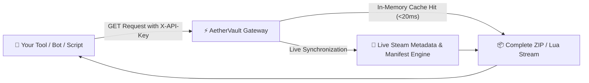

<div align="center">

```
     ___   ______ _____ _   _ _____ ______ _   _ ___   _   _ _ _____ 
    / _ \ |  ____|_   _| | | |  ___|  __  | | | / _ \ | | | | |_   _|
   / /_\ \| |__    | | | |_| | |__ | |__) | | |/ /_\ \| | | | | | |  
   |  _  ||  __|   | | |  _  |  __||  _  /| | |  _  || | | | | | |  
   | | | || |____  | | | | | | |___| | \ \| |_| | | || |_| | | | |  
   \_| |_/|______| |_| \_| |_/_____|_|  \_\\___/\_| |_/\___/  |_|  
```

# ⚡ AETHERVAULT
### *The Next-Generation Steam Depot Manifest & Lua Distribution Gateway*

<p align="center">
  <b>High-speed, enterprise-grade public gateway providing instant access to Steam game depot manifests and Lua scripts.</b><br>
  <i>Built for developers, bot creators, and game management tools to easily integrate manifest archives and configs with high availability.</i>
</p>

<p align="center">
  <a href="https://discord.gg/rhWuMYnapB"></a>
  <a href="LICENSE"></a>
  <a href="https://swagger.io"></a>
  <a href="#"></a>
</p>

[✨ 7-Day Public Trial Key](#-7-day-public-trial-key) • [🎁 1-Month Extended Access](#-want-1-month-extended-access-join-infinity-heaven) • [🏛️ Overview](#-gateway-overview) • [🛠️ Integration Guide](#-integration-guide) • [📡 REST API Reference](#-rest-api-documentation) • [💬 Community](#-official-community)

---

</div>

## 🎁 7-Day Public Trial Key

To test AetherVault immediately in your own tools, bots, or custom loaders, use our active **Public Community Trial Key**:

```http
av_public_eyJraWQiOiJiMTQ0OGM3OTBiZTkiLCJsYWJlbCI6IjctRGF5IFB1YmxpYyBDb21tdW5pdHkgVHJpYWwiLCJ0aWVyIjoicHVibGljX3RyaWFsIiwiaWF0IjoxNzkxOTc0NDkzLCJleHAiOjE3OTI1NzkyOTN9.33dbe57879d144d332a0e60abe94f89d
```

| Parameter | Policy |
| :--- | :--- |
| **Access Tier** | **7-Day Public Community Trial** |
| **Trial Quotas** | **10 requests / 24 hours** (Max **70 requests / week**) |
| **Payload Content** | Complete `.zip` (with all depot `.manifest` binaries & compiled `{appid}.lua`) |
| **Response Time** | Ultra-fast (&lt; 20ms for cached titles) |

### Quick Test in cURL:

> [!TIP]
> Run this command in your **Windows Command Prompt (CMD)**, **PowerShell**, or **Linux Terminal** to immediately download the Counter-Strike 2 manifest package:

```bash
curl -H "X-API-Key: av_public_eyJraWQiOiJiMTQ0OGM3OTBiZTkiLCJsYWJlbCI6IjctRGF5IFB1YmxpYyBDb21tdW5pdHkgVHJpYWwiLCJ0aWVyIjoicHVibGljX3RyaWFsIiwiaWF0IjoxNzkxOTc0NDkzLCJleHAiOjE3OTI1NzkyOTN9.33dbe57879d144d332a0e60abe94f89d" https://aethervault.zayrixcw.workers.dev/api/v1/manifest/730 -o 730.zip
```

---

## 🚀 Want 1-Month Extended Access? Join Infinity Heaven!

Need more than 10 requests per day for your project? Claim a **1-Month Extended Access Key** with **150 requests / day** for **FREE** by joining the **Infinity Heaven** community:

<p align="center">
  <a href="https://discord.gg/rhWuMYnapB">
    
  </a><br>
  👉 <a href="https://discord.gg/rhWuMYnapB"><b>https://discord.gg/rhWuMYnapB</b></a>
</p>

### Perks of 1-Month Infinity Heaven Key:
- ⚡ **150 Requests per day** (5x higher limit)
- 📅 **Valid for 30 Full Days**
- 🔑 **Dedicated Private API Key**
- 💬 **Direct support & request assistance in the server**

---

## 🏛️ Gateway Overview

AetherVault serves as a unified distribution layer designed for seamless manifest delivery:



<table>
  <tr>
    <td width="50%">
      <h3>⚡ Instant Caching</h3>
      <p>Repeated requests for popular titles return from memory in under 20 milliseconds, delivering rapid downloads for your users.</p>
    </td>
    <td width="50%">
      <h3>📦 Complete Manifest Packages</h3>
      <p>Each download bundles both the binary <code>.manifest</code> depot files and the corresponding Steam <code>{appid}.lua</code> configuration ready for local deployment.</p>
    </td>
  </tr>
  <tr>
    <td width="50%">
      <h3>🌐 Multi-Source Redundancy</h3>
      <p>Automatic fallback engine cross-references live SteamCMD PICS and public repository mirrors to guarantee consistent game availability.</p>
    </td>
    <td width="50%">
      <h3>🔌 Plug-and-Play Integration</h3>
      <p>Standardized HTTP interface compatible with Discord bots, desktop managers, SteamREtools, and custom CLI downloaders.</p>
    </td>
  </tr>
</table>

---

## 🛠️ Integration Guide

### 1. Python (`requests`)
```python
import requests

API_KEY = "av_public_eyJraWQiOiJiMTQ0OGM3OTBiZTkiLCJsYWJlbCI6IjctRGF5IFB1YmxpYyBDb21tdW5pdHkgVHJpYWwiLCJ0aWVyIjoicHVibGljX3RyaWFsIiwiaWF0IjoxNzkxOTc0NDkzLCJleHAiOjE3OTI1NzkyOTN9.33dbe57879d144d332a0e60abe94f89d"
GATEWAY_URL = "https://aethervault.zayrixcw.workers.dev"
APP_ID = 730  # Counter-Strike 2

headers = {"X-API-Key": API_KEY}

# Download complete manifest ZIP
response = requests.get(f"{GATEWAY_URL}/api/v1/manifest/{APP_ID}", headers=headers, stream=True)
if response.status_code == 200:
    with open(f"{APP_ID}.zip", "wb") as f:
        for chunk in response.iter_content(chunk_size=8192):
            f.write(chunk)
    print(f"Manifest package saved to {APP_ID}.zip!")
```

### 2. Python Asynchronous (`aiohttp`)
```python
import aiohttp
import asyncio

async def fetch_manifest(appid: int, api_key: str, gateway_url: str = "https://aethervault.zayrixcw.workers.dev"):
    headers = {"X-API-Key": api_key}
    async with aiohttp.ClientSession() as session:
        async with session.get(f"{gateway_url}/api/v1/manifest/{appid}", headers=headers) as resp:
            if resp.status == 200:
                data = await resp.read()
                with open(f"{appid}.zip", "wb") as f:
                    f.write(data)
                print(f"Successfully downloaded {appid}.zip ({len(data):,} bytes)")
            else:
                print(f"Error {resp.status}: {await resp.text()}")

# asyncio.run(fetch_manifest(730, "YOUR_API_KEY"))
```

### 3. JavaScript / Node.js (`fetch`)
```javascript
const fs = require('fs');

async function downloadManifest(appId, apiKey, gatewayUrl = "https://aethervault.zayrixcw.workers.dev") {
  const response = await fetch(`${gatewayUrl}/api/v1/manifest/${appId}`, {
    headers: { 'X-API-Key': apiKey }
  });

  if (response.ok) {
    const buffer = Buffer.from(await response.arrayBuffer());
    fs.writeFileSync(`${appId}.zip`, buffer);
    console.log(`Saved ${appId}.zip!`);
  } else {
    console.error(`Failed: ${response.status} ${await response.text()}`);
  }
}
```

### 4. Discord Bot (`.env`)
If you run a Discord manifest bot (such as `Manifest-Bot`), simply configure your `.env`:
```ini
MANIFEST_API_KEY=av_public_eyJraWQiOiJiMTQ0OGM3OTBiZTki...
MANIFEST_API_URL=https://aethervault.zayrixcw.workers.dev
```

---

## 📡 REST API Documentation

### Authentication Methods
Authenticate your requests using any of the following formats:
* **Header:** `X-API-Key: YOUR_API_KEY`
* **Bearer Token:** `Authorization: Bearer YOUR_API_KEY`
* **Query Parameter:** `?key=YOUR_API_KEY`

---

### Endpoints

| Method | Endpoint | Description |
| :---: | :--- | :--- |
| `GET` | `/api/v1/manifest/{appid}` | Downloads the complete manifest ZIP package (`.manifest` binaries + `{appid}.lua`). |
| `GET` | `/api/v1/lua/{appid}` | Streams the raw Steam `{appid}.lua` configuration script as text. |
| `GET` | `/api/v1/manifest/{appid}/{depot_id}` | Downloads an individual depot's binary `.manifest` file. |
| `GET` | `/api/v1/info/{appid}` | Returns JSON metadata: depot list, manifest GIDs, and archive size. |
| `GET` | `/api/v1/auth/public-key` | Retrieves the latest active 7-Day Public Trial Key. |
| `GET` | `/api/v1/health` | Returns service status and health statistics. |

---

### Request & Response Examples

<details>
<summary><b>1. Download Manifest Package (`/api/v1/manifest/{appid}`)</b></summary>

```bash
curl -H "X-API-Key: YOUR_API_KEY" https://aethervault.zayrixcw.workers.dev/api/v1/manifest/730 -o 730.zip
```
**Response:** Binary ZIP archive containing all depot manifests and `730.lua`.
</details>

<details>
<summary><b>2. Fetch Raw Lua Config (`/api/v1/lua/{appid}`)</b></summary>

```bash
curl -H "X-API-Key: YOUR_API_KEY" https://aethervault.zayrixcw.workers.dev/api/v1/lua/730
```
**Response Preview:**
```lua
-- ============================================================
-- AUTOMATED STEAM CONFIG FOR Counter-Strike 2
-- Generated via AetherVault Gateway
-- AppID:   730
-- ============================================================

addappid(730)
addappid(731, 1)
setManifestid(731, "2846174982635019283", 421092834)
addappid(732, 1)
setManifestid(732, "8293740192837401928")
```
</details>

<details>
<summary><b>3. Inspect Package Metadata (`/api/v1/info/{appid}`)</b></summary>

```bash
curl -H "X-API-Key: YOUR_API_KEY" https://aethervault.zayrixcw.workers.dev/api/v1/info/730
```
**Response:**
```json
{
  "appid": 730,
  "total_files": 9,
  "manifest_count": 8,
  "has_lua": true,
  "manifests": [
    "731_2846174982635019283.manifest",
    "732_8293740192837401928.manifest"
  ],
  "archive_size_bytes": 1420952
}
```
</details>

---

## 💬 Official Community

Join the **Infinity Heaven** Discord server for updates, 1-month API keys, and community support:

[](https://discord.gg/rhWuMYnapB)

**Discord Invite:** [https://discord.gg/rhWuMYnapB](https://discord.gg/rhWuMYnapB)

---

## 📜 License

Distributed under the **MIT License**. See [`LICENSE`](LICENSE) for details.

Maintained by [@KINGODIN1124](https://github.com/KINGODIN1124)
